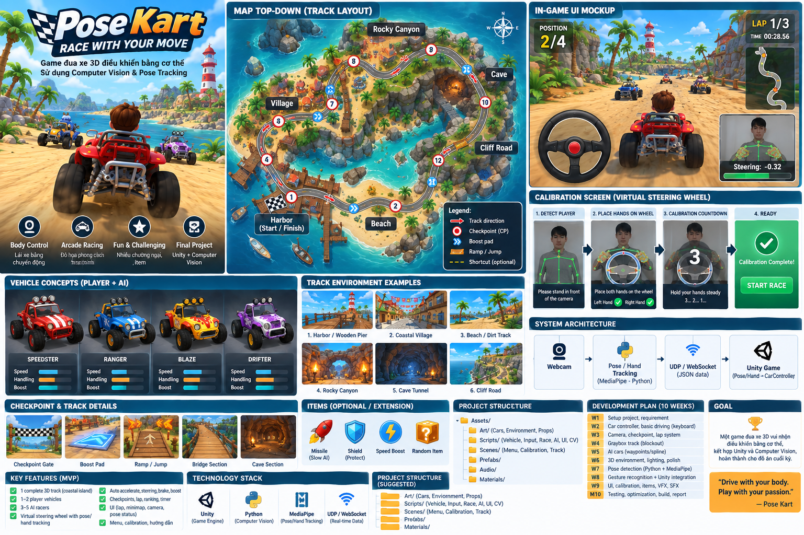
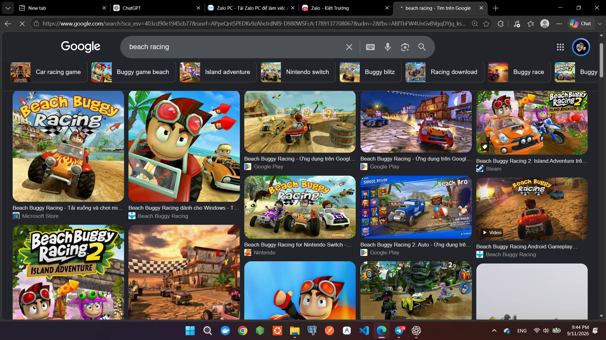
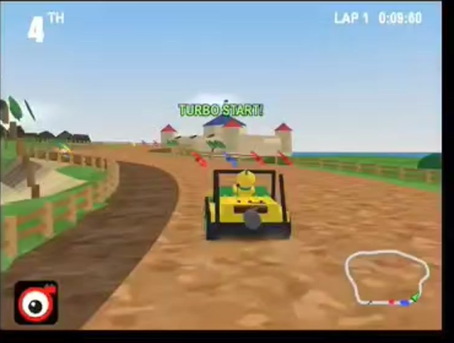
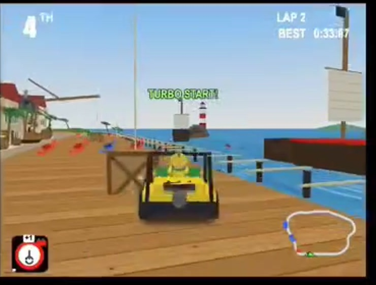
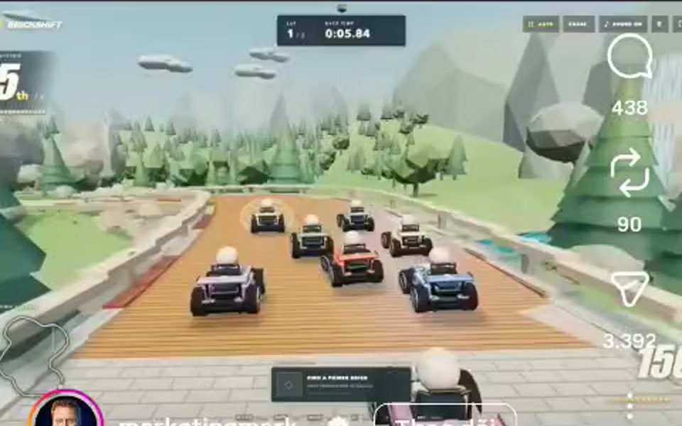

# POSE KART — UNITY + COMPUTER VISION FINAL PROJECT PLAN

> **Mục đích của file này:** đưa thẳng cho Codex để Codex hiểu concept, scope, kiến trúc, thứ tự triển khai, acceptance criteria, asset/reference và các quyết định kỹ thuật chính trước khi viết code.
>
> **Nguyên tắc:** làm một game đua xe arcade 3D nguyên bản, lấy cảm hứng về nhịp độ/mood từ các game buggy racing ven biển. Không sao chép map, model, logo, UI, âm thanh hoặc asset có bản quyền của game tham khảo.

---

## Visual handoff pack (đọc trước khi triển khai art/UI/map)

Bộ này đã có ảnh/video vật lý nằm trong `references/`; Codex **không cần tự tải ảnh trên mạng**. Hãy inspect toàn bộ thư mục đó.

Các file quan trọng nhất:

- `references/00_pose_kart_master_design_board.png` — concept tổng thể
- `references/10_map_topdown_visual.png` — map top-down stylized
- `references/11_ingame_ui_visual.png` — mockup gameplay HUD + webcam + virtual wheel
- `references/12_calibration_ui_visual.png` — mockup calibration
- `references/13_vehicle_reference_visual.png` — xe buggy reference
- `references/14_environment_reference_visual.png` — environment reference
- `references/17_exact_track_schematic.svg` và `18_exact_track_schematic.png` — **source of truth cho checkpoint/track logic**

Nếu ảnh concept mâu thuẫn với tài liệu text, ưu tiên text và exact schematic.

---

## 0. Codex — đọc phần này trước khi code

Bạn là senior Unity gameplay engineer + computer-vision integration engineer.

Hãy triển khai project theo **từng milestone nhỏ, chạy được**, không viết toàn bộ hệ thống một lần. Mọi module phải tách rời để game vẫn chạy bằng keyboard ngay cả khi CV chưa hoạt động.

### Quy tắc bắt buộc

1. **Không gắn CV trực tiếp vào `CarController`.** Mọi input đi qua `ICarInputProvider`.
2. Luôn có `KeyboardInputProvider` để debug/fallback.
3. `PoseInputProvider` chỉ nhận dữ liệu điều khiển chuẩn hóa: `steering`, `throttle`, `brake`, `boost`, `trackingValid`.
4. CV chạy ngoài Unity bằng Python trước; giao tiếp Unity qua UDP localhost. Nếu project ổn định và còn thời gian mới xem xét đưa inference vào Unity.
5. Không thêm package mới nếu chưa cần. Nếu project đã có URP/Cinemachine thì tận dụng; nếu chưa có thì không ép nâng cấp project.
6. Mỗi milestone phải có scene test hoặc cách test cụ thể.
7. Code C# namespace rõ ràng, serialized field private, tránh singleton tràn lan.
8. Không copy asset/hình/model từ Beach Buggy Racing. Chỉ dùng làm mood/reference.
9. Ưu tiên **MVP hoàn chỉnh** hơn nhiều tính năng dang dở.
10. Nếu gặp mâu thuẫn giữa file này và codebase hiện có, ưu tiên giữ project build được, ghi chú rõ thay đổi cần thiết.

### Definition of Done tổng thể

Game được xem là hoàn thành khi:

- Có 1 track coastal stylized hoàn chỉnh, chạy 3 vòng.
- Có 1 xe người chơi + ít nhất 3 xe AI.
- Có countdown, checkpoint, lap, ranking, finish screen.
- Keyboard control hoạt động ổn định.
- Webcam/CV detect người chơi và hiển thị calibration.
- Vô lăng ảo xuất hiện; hai tay “grip” được hai vùng của vô lăng.
- Xoay hai tay làm vô lăng ảo xoay và xe đánh lái theo.
- Có smoothing, deadzone, xử lý mất tracking.
- Có overlay debug CV với angle/steering/FPS/latency/tracking state.
- Có build chạy được trên máy demo.

---

# 1. Concept tổng thể

**Tên tạm:** Pose Kart / Motion Buggy Racing  
**Thể loại:** 3D Arcade Racing  
**Engine:** Unity  
**Điều khiển chính:** Webcam + Pose/Hand Tracking + Virtual Steering Wheel  
**Phong cách:** stylized / low-poly / tropical coastal racing  
**Camera:** third-person chase camera  
**Race:** 3 laps, 4 racers (1 player + 3 AI) cho MVP

## Hình concept tổng quan



Ảnh trên là concept định hướng cho project: coastal track, buggy cars, webcam overlay, vô lăng ảo, flow calibration và kiến trúc CV → Unity.

---

# 2. Tài liệu tham khảo từ người dùng

## 2.1. Beach buggy mood/reference



Chỉ tham khảo các yếu tố ở mức **ngôn ngữ thiết kế**:

- buggy nhỏ, bánh lớn;
- màu sắc vui, arcade;
- tropical/coastal village;
- dirt road + stone road + pier;
- camera bám sau xe;
- minimap, lap, position;
- boost/turbo feedback mạnh.

Không copy model, texture, logo, map layout hay UI cụ thể.

## 2.2. Video tham khảo

Video gốc: `references/reference_video.mp4`

Một số frame/crop:







Điểm nên học từ video:

- đường đua dễ đọc từ camera thứ ba;
- track có thay đổi vật liệu/môi trường;
- checkpoint/boost dễ nhận biết;
- minimap nhỏ nhưng đủ định hướng;
- environment low-poly giúp tối ưu thời gian sản xuất.

---

# 3. Player Experience Flow

```text
Main Menu
   ↓
Start Game
   ↓
Camera Permission / Camera Ready
   ↓
Detect Player
   ↓
Show Virtual Steering Wheel
   ↓
Place Left + Right Hand on Grip Zones
   ↓
Calibration 3 → 2 → 1
   ↓
Race Countdown 3 → 2 → 1 → GO
   ↓
3-Lap Race
   ↓
Finish Results
   ↓
Retry / Main Menu
```

## State machine đề xuất

```text
BOOT
  └──> MAIN_MENU
          └──> CAMERA_SETUP
                  └──> WAITING_FOR_PLAYER
                          └──> WHEEL_CALIBRATION
                                  └──> RACE_COUNTDOWN
                                          └──> RACING
                                                  └──> FINISHED
```

Nếu camera/CV lỗi: cho phép **Keyboard Fallback**.

---

# 4. Gameplay Core

## MVP controls

| Input | Hành động |
|---|---|
| Hai tay cầm vô lăng ảo | Cho phép steering; auto-throttle |
| Xoay hai tay trái/phải | Steering |
| Hai tay hạ xuống khỏi neutral wheel pose | Brake |
| Tay phải giơ lên quá vai trong >= 0.35 s | Boost pulse |
| Mất tracking > 0.5 s | Steering về 0, giảm ga, hiện cảnh báo |
| Keyboard | W/S/A/D hoặc arrows, Space boost |

### Lưu ý

Steering là tính năng CV bắt buộc. Brake/Boost gesture có thể triển khai sau steering để giảm rủi ro deadline.

---

# 5. Virtual Steering Wheel — thiết kế chi tiết

## 5.1. Landmark cần dùng

Pose:

- Left Shoulder
- Right Shoulder
- Left Elbow
- Right Elbow
- Left Wrist
- Right Wrist
- Left Hip
- Right Hip

Optional hand tracking:

- Handedness
- Wrist + palm landmarks

## 5.2. Calibration

Trong 2–3 giây đầu:

1. Xác định shoulder center.
2. Tính shoulder width.
3. Xác định wheel center tương đối với thân người.
4. Scale wheel radius theo shoulder width.
5. Lưu neutral hand line angle.
6. Sau calibration, **freeze wheel position/scale** cho session để UI không rung theo người.

Pseudo:

```text
shoulderCenter = (leftShoulder + rightShoulder) / 2
shoulderWidth  = distance(leftShoulder, rightShoulder)
wheelCenter.x  = shoulderCenter.x
wheelCenter.y  = shoulderCenter.y + shoulderWidth * Y_OFFSET
wheelRadius    = shoulderWidth * RADIUS_SCALE
```

Tất cả tọa độ nên normalized 0..1.

## 5.3. Grip zones

Tạo hai vùng grip ở khoảng 9 giờ và 3 giờ.

```text
          wheel top
              |
     [L GRIP]     [R GRIP]
          \         /
           \       /
             ( O )
```

Điều kiện:

```text
leftGrip  = distance(leftWrist, leftGripPoint)   < gripThreshold
rightGrip = distance(rightWrist, rightGripPoint) < gripThreshold
```

Chỉ khi cả hai grip valid mới dùng full two-hand steering.

## 5.4. Steering angle

```text
L = left wrist
R = right wrist
V = R - L
angle = atan2(-(R.y - L.y), R.x - L.x)
```

Dấu `-` ở trục Y vì screen coordinate thường tăng từ trên xuống.

Sau khi trừ neutral angle:

```text
rawAngle = angle - neutralAngle
```

Normalize:

```text
steering = clamp(rawAngle / maxPoseAngle, -1, +1)
```

Default gợi ý:

```text
maxPoseAngle = 55°
deadZone     = 4°
EMA alpha    = 0.25
```

## 5.5. Smoothing

Không đưa giá trị raw trực tiếp vào xe.

```text
smoothed = previous + (current - previous) * alpha
```

Có thể dùng `Mathf.SmoothDamp` phía Unity sau khi nhận packet.

## 5.6. Mirror rule

Webcam preview có thể mirror để tự nhiên với người chơi, nhưng protocol giữa Python và Unity phải thống nhất.

Quy ước đề xuất:

- Python gửi coordinate theo **display-mirrored coordinate**.
- Left/right handedness vẫn giữ semantic đúng sau mirror.
- Test bắt buộc: xoay tay sang trái → wheel UI xoay trái → xe cua trái.

## 5.7. Tracking lost

```text
confidence < threshold for 0.15s:
    show warning

tracking lost > 0.5s:
    steering -> smoothly 0
    throttle -> 0.25
    boost -> false

tracking lost > 1.5s:
    pause race OR auto-brake, tùy gameplay test
```

---

# 6. CV Debug Overlay

Overlay nhỏ ở góc phải màn hình:

```text
┌────────────────────────────┐
│ Webcam preview             │
│ pose skeleton              │
│ virtual wheel + grip pts   │
│                            │
│ Pose: GOOD                 │
│ Left Grip:  ✓              │
│ Right Grip: ✓              │
│ Angle:      -18.4°         │
│ Steering:   -0.33          │
│ FPS:         30            │
│ Latency:     42 ms         │
└────────────────────────────┘
```

Debug overlay phải bật/tắt được bằng một key, ví dụ `F3`.

---

# 7. Technical Architecture

```text
                         PLAYER
                           │
                        Webcam
                           │
                           ▼
               Python CV Application
          OpenCV + MediaPipe Pose/Hands
                           │
             normalize / smooth / gesture
                           │
                           ▼
                  UDP JSON localhost
                           │
                           ▼
┌─────────────────────────────────────────────────────────┐
│                         UNITY                           │
│                                                         │
│ PoseUdpReceiver                                         │
│      │                                                  │
│      ▼                                                  │
│ PoseInputProvider ───────┐                              │
│                         ▼                              │
│ KeyboardInputProvider → ICarInputProvider              │
│                         │                              │
│                         ▼                              │
│                   CarController                        │
│                         │                              │
│                  Rigidbody Physics                     │
│                                                         │
│ RaceManager → Checkpoints → Laps → Ranking             │
│ AIController → Waypoints/Spline → AI Cars              │
│ UIManager → HUD / Calibration / Debug                  │
└─────────────────────────────────────────────────────────┘
```

---

# 8. UDP Protocol

## Python → Unity packet

Port gợi ý: `5052`

```json
{
  "timestamp": 1730000000.123,
  "trackingValid": true,
  "confidence": 0.94,
  "leftGrip": true,
  "rightGrip": true,
  "wheelAngleDeg": -18.4,
  "steering": -0.33,
  "throttle": 1.0,
  "brake": 0.0,
  "boost": false,
  "poseFps": 30.0
}
```

## Unity requirements

- Receiver thread không block main thread.
- Chỉ lưu packet mới nhất.
- Main thread đọc snapshot trong `Update`.
- Có timeout nếu không nhận packet trong 0.5 s.
- Không log mỗi packet ở production mode.

---

# 9. Unity Folder Structure

```text
Assets/
├── Art/
│   ├── Vehicles/
│   ├── Environment/
│   ├── Props/
│   ├── Materials/
│   └── Textures/
├── Audio/
├── Prefabs/
│   ├── Vehicles/
│   ├── Track/
│   ├── Race/
│   ├── UI/
│   └── VFX/
├── Scenes/
│   ├── MainMenu.unity
│   ├── CVCalibration.unity
│   ├── CoastalTrack.unity
│   └── SandboxVehicle.unity
├── Scripts/
│   ├── Core/
│   ├── Vehicle/
│   ├── Input/
│   ├── CV/
│   ├── Race/
│   ├── AI/
│   ├── Camera/
│   └── UI/
└── Settings/

cv/
├── app.py
├── pose_tracker.py
├── virtual_wheel.py
├── gesture_interpreter.py
├── udp_sender.py
├── requirements.txt
└── README.md
```

---

# 10. C# interfaces/classes cần có

## 10.1. Input interface

```csharp
public interface ICarInputProvider
{
    float Steering { get; }
    float Throttle { get; }
    float Brake { get; }
    bool BoostPressed { get; }
    bool IsInputValid { get; }
}
```

## 10.2. Classes

```text
Vehicle/
  CarController
  ArcadeVehiclePhysics
  VehicleVisuals
  VehicleAudio

Input/
  ICarInputProvider
  KeyboardInputProvider
  PoseInputProvider
  InputProviderSwitcher

CV/
  PoseUdpReceiver
  PosePacket
  TrackingState

Race/
  RaceManager
  Checkpoint
  CheckpointSequence
  LapTracker
  RacePositionCalculator

AI/
  AIInputProvider
  AIWaypointPath / AISplinePath
  AIDriver

UI/
  MainMenuUI
  CalibrationUI
  VirtualWheelUI
  RaceHUD
  CVDebugOverlay
  FinishUI
```

---

# 11. Car Physics — arcade, không simulation nặng

Mục tiêu cảm giác:

- tăng tốc nhanh;
- steering responsive;
- không lật xe dễ;
- drift nhẹ ở cua nhanh;
- va chạm vui, không quá thực tế.

## Gợi ý implementation

MVP có thể dùng Rigidbody custom forces thay vì WheelCollider phức tạp.

Các thông số ScriptableObject:

```text
MaxForwardSpeed
Acceleration
ReverseSpeed
SteeringStrength
SteeringAtHighSpeedMultiplier
LateralGrip
Downforce
BrakeStrength
BoostForce
BoostDuration
BoostCooldown
```

Acceptance test:

- Keyboard A/D steering ổn ở 30–120 FPS.
- Xe không rung khi đứng yên.
- Xe tự hồi hướng hợp lý.
- Xe không bay/lật quá dễ khi chạm curb.

---

# 12. Map Design — 1 track duy nhất nhưng có 5 biome/zone

## Track flow

```text
START/FINISH
    ↓
1. Harbor / Wooden Pier
    ↓
2. Coastal Village
    ↓
3. Beach / Dirt Track
    ↓
4. Rocky Canyon + Cave
    ↓
5. Cliff Road
    ↓
Back to Harbor
```

## Zone 1 — Harbor / Wooden Pier

Props:

- wooden pier;
- crates/barrels;
- fishing boat silhouettes;
- rope fence;
- lighthouse landmark;
- flags/banners;
- sea + foam VFX.

Gameplay:

- start grid rộng;
- cua nhẹ đầu tiên;
- landmark rõ để nhớ start/finish.

## Zone 2 — Coastal Village

Props:

- stucco/white houses;
- red/orange roofs;
- stone road;
- market stalls;
- palm trees;
- lamps/signs.

Gameplay:

- đường hẹp hơn;
- 2–3 cua liên tục;
- có shortcut chỉ nếu còn thời gian.

## Zone 3 — Beach / Dirt

Props:

- sand;
- dirt road;
- beach rocks;
- palms;
- wood fences;
- boost pads.

Gameplay:

- đường rộng;
- drift corner lớn;
- 1 small ramp.

## Zone 4 — Canyon + Cave

Props:

- rock walls;
- arch;
- cave tunnel;
- torch/emissive lights;
- stone debris.

Gameplay:

- sharp corner;
- lighting contrast;
- short tunnel.

## Zone 5 — Cliff Road

Props:

- cliff rocks;
- guard fences;
- ocean panorama;
- lighthouse visible in distance.

Gameplay:

- long fast curve;
- quay về start/finish.

## Track graybox dimensions gợi ý

- Track width normal: 8–12 m.
- Start grid: 14–18 m.
- Minimum turn radius: tránh quá nhỏ khi dùng pose control.
- Lap time mục tiêu: 60–90 s.
- Full race: khoảng 3–5 phút.

Quan trọng: **Pose steering cần track dễ đọc và không quá nhiều hairpin nhỏ.**

---

# 13. Vehicle Art Direction

Xe nên là **original stylized buggy**:

- thân xe ngắn;
- bánh lớn;
- suspension exaggerated;
- roll cage;
- 2–4 head lamps;
- màu sắc sáng;
- silhouette rõ khi nhìn từ sau.

MVP:

- 1 mesh xe chính;
- 3 color variants cho AI;
- material instance khác nhau, không cần 4 model riêng.

Animation/visual:

- bánh quay;
- bánh trước steer;
- suspension fake hoặc minimal;
- dust trail khi chạy dirt;
- boost flame/particles.

---

# 14. Camera

Third-person chase camera:

- follow position bằng SmoothDamp;
- look-at target phía trên thân xe;
- FOV tăng nhẹ khi boost;
- tránh camera clip terrain bằng raycast nếu cần.

Không để camera quá gần vì pose steering có thể tạo steering oscillation nhẹ; camera ổn định giúp người chơi dễ điều khiển hơn.

---

# 15. Race System

## Checkpoint order

```text
CP0 → CP1 → CP2 → ... → CPN → Finish
```

Lap chỉ tăng nếu đi đủ checkpoint đúng thứ tự.

## Race position

Score tiến độ:

```text
progress = lap * trackLength
         + currentCheckpointDistanceAlongTrack
         + localProgressToNextCheckpoint
```

Nếu chưa có spline distance, MVP dùng:

```text
lap
+ checkpointIndex
+ inverseDistanceToNextCheckpoint
```

## HUD

- `Position 2/4`
- `Lap 1/3`
- timer
- boost bar
- minimap optional/should-have
- CV status small indicator

---

# 16. AI Opponents

Không dùng ML/Reinforcement Learning.

MVP:

- waypoint hoặc spline path;
- target look-ahead;
- steering theo signed angle;
- throttle giảm khi turn angle lớn;
- random lateral offset nhỏ để AI không chạy cùng một line;
- rubber-banding rất nhẹ optional.

AI cũng implement `ICarInputProvider` để dùng cùng `CarController`.

---

# 17. UI Screens

## Main Menu

- Play
- Settings
- Quit
- Input mode: Pose / Keyboard (debug)

## Calibration UI

- webcam preview;
- skeleton;
- virtual wheel;
- left/right grip indicators;
- text instruction;
- 3-2-1 calibration.

## Race HUD

- lap;
- position;
- time;
- boost;
- small tracking indicator;
- optional minimized webcam preview.

## Finish

- rank;
- total time;
- best lap;
- Retry;
- Main Menu.

---

# 18. Visual Wheel UI

Vô lăng là UI overlay, không phải vật thể người chơi thật sự cầm.

Requirements:

- wheel xuất hiện trong calibration;
- grip points đổi trạng thái gray → green khi tay vào vùng;
- wheel quay theo `wheelAngleDeg`;
- khi racing, có thể thu nhỏ hoặc giảm opacity;
- lost tracking: wheel đổi trạng thái warning;
- UI phải hoạt động ở 16:9 trước.

Optional:

- pulse animation khi cả hai grip lock;
- countdown ring quanh wheel;
- ghost hand icons hướng dẫn.

---

# 19. Python CV module

## Stack đề xuất

- Python 3.10/3.11 theo package compatibility;
- OpenCV;
- MediaPipe Pose/Hands hoặc equivalent;
- `socket` UDP;
- `time` for timestamps.

## Processing loop

```text
Capture frame
  ↓
Mirror frame for player view
  ↓
Pose / hand inference
  ↓
Landmark confidence filter
  ↓
Calibration transform
  ↓
Grip detection
  ↓
Wheel angle
  ↓
Deadzone + smoothing
  ↓
Brake/boost gesture
  ↓
Send latest UDP packet
  ↓
Draw debug preview
```

Target:

- 20–30 FPS CV;
- end-to-end latency < 100 ms nếu có thể;
- game vẫn 60 FPS nếu CV chạy process riêng.

---

# 20. Milestones / Implementation Plan

## Milestone 1 — Vehicle Sandbox

Deliverable:

- `SandboxVehicle` scene;
- cube/placeholder car chạy bằng keyboard;
- chase camera;
- stable Rigidbody.

Acceptance:

- chạy, cua, brake, boost;
- no CV yet.

## Milestone 2 — Race Loop

Deliverable:

- graybox track;
- checkpoints;
- 3 laps;
- countdown;
- finish.

Acceptance:

- 1 player chạy đủ race bằng keyboard.

## Milestone 3 — AI

Deliverable:

- 3 AI cars;
- waypoint path;
- ranking.

Acceptance:

- full 4-car race hoàn tất.

## Milestone 4 — Environment Pass

Deliverable:

- 5 zones;
- low-poly props;
- materials/lighting;
- VFX dust/boost.

Acceptance:

- track visually recognizable by zone.

## Milestone 5 — Python Pose Prototype

Deliverable:

- webcam;
- pose skeleton;
- wrist coordinates;
- FPS display.

Acceptance:

- stable pose detect under demo lighting.

## Milestone 6 — Virtual Wheel

Deliverable:

- calibration;
- wheel/grip UI in Python debug or Unity;
- wheel angle;
- smoothing/deadzone.

Acceptance:

- rotate hands left/right → normalized steering reliable.

## Milestone 7 — Unity CV Integration

Deliverable:

- UDP receiver;
- PoseInputProvider;
- input switcher.

Acceptance:

- same car controllable by keyboard or pose without changing CarController.

## Milestone 8 — Gesture/Resilience

Deliverable:

- tracking lost logic;
- brake;
- boost;
- debug overlay;
- calibration UX.

Acceptance:

- CV errors fail safely.

## Milestone 9 — Polish

Deliverable:

- UI;
- audio;
- particles;
- minimap optional;
- optimization.

## Milestone 10 — Evaluation / Final Demo

Collect:

- lap time keyboard vs pose;
- collision count;
- gesture accuracy;
- latency;
- user rating.

Prepare demo flow:

1. show keyboard fallback;
2. show CV skeleton;
3. show calibration;
4. show steering wheel response;
5. play one lap;
6. toggle debug overlay;
7. explain architecture.

---

# 21. 10-week schedule

| Tuần | Mục tiêu |
|---|---|
| 1 | Setup repo, requirements, vehicle sandbox |
| 2 | Arcade car physics + keyboard + camera |
| 3 | Graybox track + checkpoint + lap |
| 4 | AI + ranking + full race loop |
| 5 | Environment first pass |
| 6 | Python pose/hand tracking prototype |
| 7 | Virtual wheel calibration + steering math |
| 8 | UDP → Unity + PoseInputProvider |
| 9 | Gesture, UI, debug, polish |
| 10 | Testing, optimize, report, build, demo |

---

# 22. Testing checklist

## Vehicle

- [ ] car does not jitter at rest
- [ ] steering works at low/high speed
- [ ] boost cooldown works
- [ ] reset car if flipped/off-track

## Race

- [ ] cannot skip checkpoints
- [ ] lap increments correctly
- [ ] ranking correct around finish line
- [ ] AI can finish 3 laps

## CV

- [ ] one person detected reliably
- [ ] left/right wrist not swapped after mirror
- [ ] grip zones stable
- [ ] steering left/right sign correct
- [ ] deadzone prevents jitter
- [ ] tracking lost recovers safely
- [ ] packet timeout handled

## UI

- [ ] calibration instructions understandable
- [ ] wheel rotation matches hands
- [ ] webcam overlay can be hidden
- [ ] race HUD readable at 1920x1080

## Performance

- [ ] Unity target 60 FPS on demo machine
- [ ] Python CV target >= 20 FPS
- [ ] latency target < 100 ms if feasible

---

# 23. Scope control

## MUST HAVE

- 1 original coastal track
- 1 buggy + AI color variants
- keyboard control
- 3 AI
- race loop
- virtual wheel
- pose steering
- calibration
- UDP integration
- debug overlay

## SHOULD HAVE

- boost gesture
- brake gesture
- minimap
- drift VFX
- audio
- better props/lighting

## NICE TO HAVE — chỉ làm nếu MVP xong

- power-ups
- missiles/shields
- character select
- multiple cars
- multiple tracks
- split screen
- online multiplayer
- ML-based AI driving

Không làm NICE TO HAVE trước khi full MVP chơi được.

---

# 24. Asset strategy

Codex không nên tự tạo/copy copyrighted game assets.

Cho prototype:

- dùng primitive/graybox;
- dùng asset free/CC0 nếu có sẵn trong repo;
- hoặc placeholder materials/colors.

Sau đó thay bằng original/free assets với license rõ ràng.

Asset categories cần tìm/tạo:

```text
Buggy vehicle
Palm trees
Low-poly rocks
Coastal houses
Wooden pier modules
Crates / barrels
Wood fences
Lighthouse
Cave rocks
Road/dirt/sand materials
Flags / banners
Boost pad
Dust particles
Sea shader/material
```

---

# 25. Suggested first Codex task

**Không bắt đầu bằng CV.** Bắt đầu bằng input abstraction + vehicle sandbox.

Prompt thực thi đầu tiên:

> Inspect the existing Unity project. Do not upgrade Unity or add packages unless necessary. Create the minimum architecture for an arcade racing vehicle with `ICarInputProvider`, `KeyboardInputProvider`, and `CarController`. Add a `SandboxVehicle` test scene if safe to do so. Use placeholder geometry only. The vehicle must accelerate, brake, steer, and boost through the input interface. Keep the car controller independent of keyboard and future pose tracking. After changes, report files created/modified, how to test, and any assumptions. Do not implement CV yet.

Sau khi milestone 1 ổn, prompt tiếp:

> Implement the race loop using ordered checkpoints, lap tracking, countdown, finish state, and a simple HUD. Keep systems modular. Use the existing vehicle and keyboard input. Do not implement AI or CV yet. Provide a test checklist.

Sau đó mới lần lượt AI → map → CV → integration.

---

# 26. Final architecture target

```text
           ┌─────────────────────┐
           │      WEBCAM         │
           └─────────┬───────────┘
                     ▼
           ┌─────────────────────┐
           │ PYTHON CV PROCESS   │
           │ Pose + Hands        │
           │ Calibration         │
           │ Virtual Wheel Math  │
           │ Gesture Detection   │
           └─────────┬───────────┘
                     │ UDP JSON
                     ▼
           ┌─────────────────────┐
           │  PoseUdpReceiver    │
           └─────────┬───────────┘
                     ▼
           ┌─────────────────────┐
           │ PoseInputProvider   │
           └─────────┬───────────┘
                     │
KeyboardInputProvider┤
AIInputProvider──────┤
                     ▼
           ┌─────────────────────┐
           │    CarController    │
           └─────────┬───────────┘
                     ▼
           ┌─────────────────────┐
           │ Rigidbody / Arcade  │
           │ Vehicle Physics     │
           └─────────────────────┘

RaceManager ─ Checkpoints ─ LapTracker ─ Ranking
AI Path ─ AI Driver ─ AIInputProvider
UI ─ Calibration ─ Virtual Wheel ─ HUD ─ Debug
```

---

# 27. Project success criteria for final presentation

Một buổi demo tốt nên cho giảng viên thấy đúng chuỗi sau:

1. Game track và AI hoạt động bình thường bằng keyboard.
2. Bật webcam và thấy skeleton/landmarks.
3. Người chơi đặt tay lên hai grip của vô lăng ảo.
4. Calibration hoàn tất.
5. Người chơi xoay hai tay; wheel UI xoay tương ứng.
6. Xe trong Unity cua trái/phải theo wheel.
7. Hiện debug: angle, steering, confidence, FPS, latency.
8. Mất pose tạm thời; game xử lý an toàn rồi recover.
9. Kết thúc lap/race và hiển thị kết quả.
10. Trình bày so sánh keyboard vs pose bằng vài metric cơ bản.

Nếu 10 bước này chạy trơn tru, đồ án đã có đủ game development + physics + AI + computer vision + HCI + system integration để bảo vệ tốt.

---

# 28. Reference file index

```text
references/
├── pose_kart_concept_overview.png
├── beach_buggy_google_reference.png
├── reference_video.mp4
├── video_frame_01.jpg
├── video_frame_02.jpg
├── video_frame_03.jpg
├── video_top_gameplay_crop.jpg
├── video_pier_gameplay_crop.jpg
└── video_lowpoly_race_crop.jpg
```

**End of plan.**
